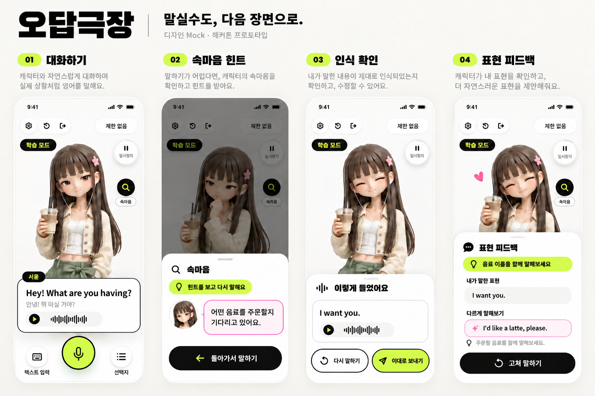
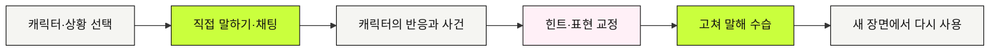

# 오답극장

### 말실수도, 다음 장면으로.

AI 캐릭터와 이야기하고, 뜻밖의 장면을 만나고, 다시 말해보는 영어 연습.

**2026 InThon · 해커톤 프로토타입 · 개발 중**

[서비스 이야기](#틀려도-이야기는-계속돼요) · [화면 미리보기](#화면-미리보기) · [함께 만드는 저장소](#함께-만드는-저장소)

## 틀려도 이야기는 계속돼요

머릿속에서는 완벽했던 영어가 입 밖으로 나오면 조금 달라질 때가 있죠.
오답극장에서는 그 순간도 하나의 장면이 됩니다.

카페에서 음료를 주문하려다 <strong>“I want you.”</strong>라고 말했다면?
캐릭터가 <strong>“Me? I'm not on the menu!”</strong>라고 장난스럽게 되물을 수도 있어요.
뜻이 어떻게 달라졌는지 확인하고 <strong>“I'd like a latte, please.”</strong>로 고쳐 말해보세요.
수습한 표현은 다음 장면에서 다시 써보면 됩니다.

> **말실수 → 뜻밖의 사건 → 힌트와 교정 → 고쳐 말하기 → 새로운 상황에서 다시 쓰기**

## 화면 미리보기

  

*위 이미지는 목표 경험을 보여주는 디자인 Mock입니다. 실제 앱 실행 화면은 아니며, 네 화면은 학습 모드의 예시예요. 이미지를 누르면 크게 볼 수 있어요.*

| 이렇게 시작해요 | 이런 경험을 만들고 있어요 |
| --- | --- |
| **캐릭터와 장면 고르기** | 관계·성격·직업·상황이 다른 상대와 영어 대화를 시작해요. |
| **직접 말하거나 입력하기** | 음성으로 말하고, 인식된 문장을 확인한 뒤 보내요. 채팅으로도 이어갈 수 있어요. |
| **보고, 듣고, 힌트 얻기** | 캐릭터의 표정과 목소리를 살펴봐요. 막히면 돋보기로 캐릭터의 속마음 힌트를 확인해요. |
| **고쳐 말하고 다시 쓰기** | 내 표현이 어떻게 전달됐는지 알아보고, 더 잘 맞는 표현을 다른 장면에서도 써봐요. |

속마음은 장면 속 **허구 캐릭터의 목표와 걱정**을 보여주는 힌트예요.
표현 피드백은 확인한 문장의 의미·문법·상황 적절성을 중심으로 설계하고 있어요.

## 내 속도로 연습하고, 실전처럼 도전해요

| 학습 모드 | 실전 모드 |
| --- | --- |
| 시간과 목숨 제한 없이 생각하고, 고쳐 말하고, 반복해요. | 제한된 기회와 발화 준비시간 안에서 대화를 이어가요. |
| 힌트와 교정을 보며 장면을 익혀요. | 배운 표현으로 장면을 수습하고 엔딩에 도전해요. |

실전의 기회 수와 준비시간은 사용자 테스트를 통해 다듬을 설계값이에요.
음성 인식 확인·힌트·피드백·기술 오류 때문에 불리해지지 않는 흐름을 만들고 있습니다.

## 한 번의 대화가 다음 연습으로

## 함께 만드는 저장소

| 저장소 | 담당하는 일 |
| --- | --- |
| [AI · ai](https://github.com/2026-INTHON/ai) | 캐릭터 대사, 표현 평가·교정, 상황 생성 |
| [FE · frontend](https://github.com/2026-INTHON/frontend) | React Native·Expo 앱, 녹음·재생, 캐릭터와 대화 화면 |
| [BE · backend](https://github.com/2026-INTHON/backend) | API, 장면 분기와 세션 상태, 학습 기록 |

오답극장은 **2026 InThon에서 만들고 있는 프로젝트**입니다.
이 페이지는 우리가 만들고 싶은 사용 경험을 소개하며, 구현과 검증을 진행하면서 업데이트합니다.

**틀린 한마디가, 다음 한마디를 더 쉽게.**

