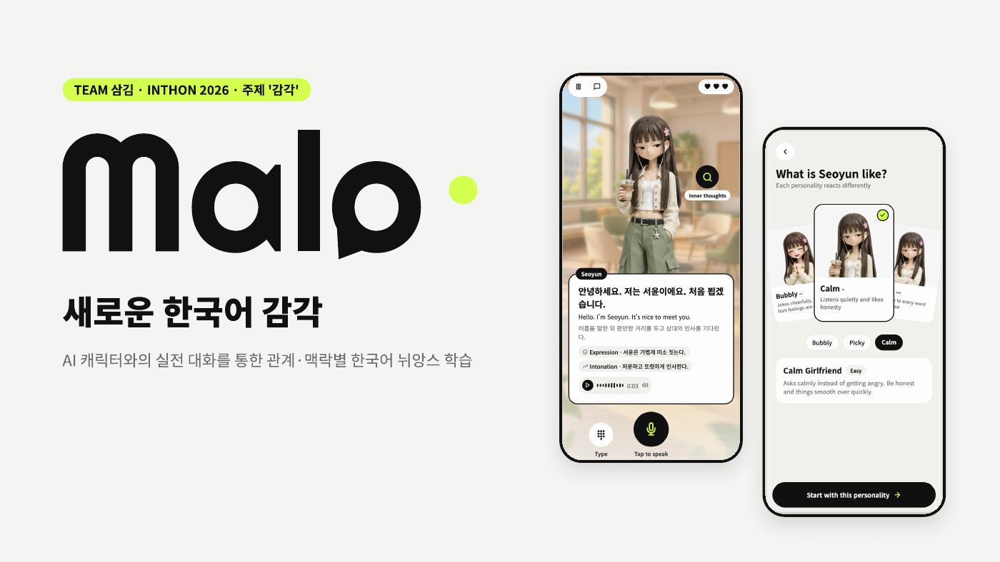
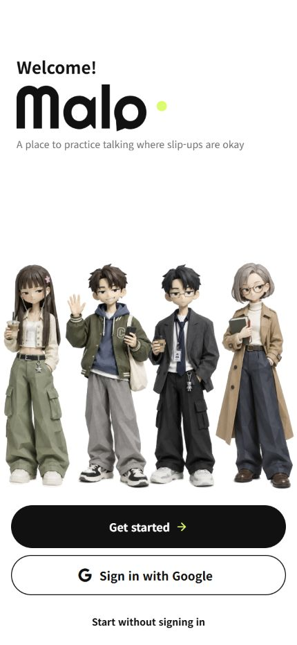
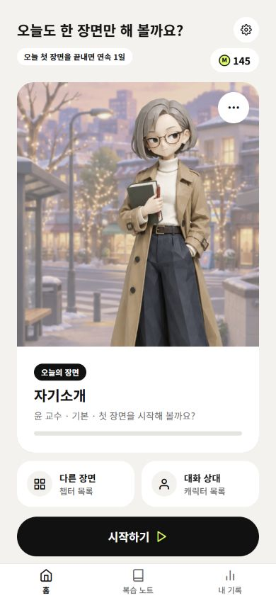
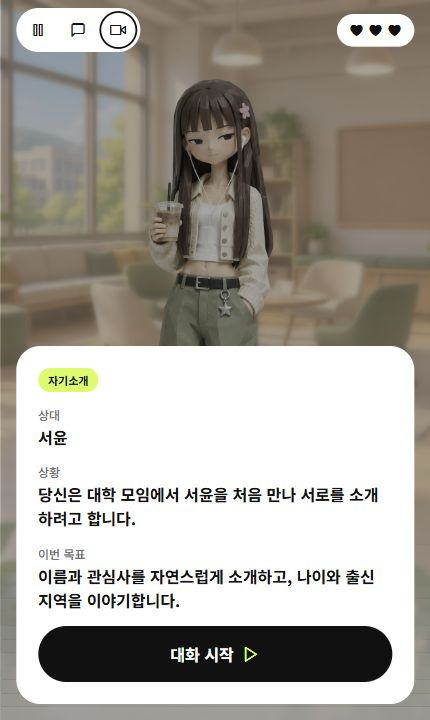
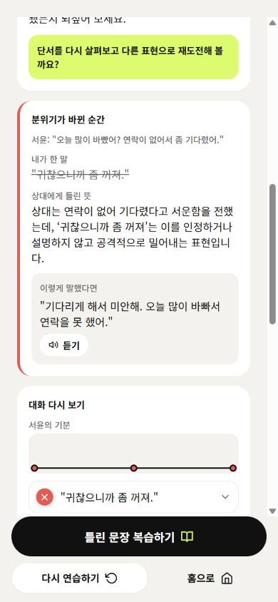
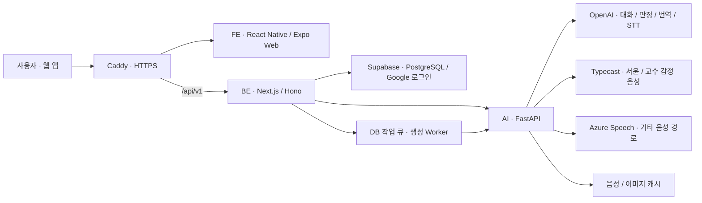

# Malo · 새로운 한국어 감각

**AI 캐릭터와 대화하며, 관계와 맥락에 맞는 한국어를 연습합니다.**

TEAM 삼김 · INTHON 2026 · 주제 **감각**

[서비스 시작하기](https://inthon-demo-20261031-dh.koreacentral.cloudapp.azure.com/) · [화면 미리보기](#화면-미리보기) · [기술과 구조](#기술과-구조) · [저장소](#함께-만드는-저장소)

## 문법을 넘어, 말의 의도까지

“다음에 밥 한번 먹어요.” 진짜 약속일까요, 가벼운 인사일까요?

한국어를 알아도 **간접적인 거절, 관계에 따른 높임말, 말투와 표정의 뉘앙스**는 낯설 수 있습니다. Malo는 이런 감각을 실제 대화처럼 연습하는 한국어 학습 서비스입니다. 주요 대상은 일상적인 한국어를 배우고 있는 외국인 유학생입니다.

캐릭터의 말을 듣고 단서를 살펴보세요. 직접 답하고, 상대의 반응을 확인하고, 더 적절한 표현으로 다시 말해볼 수 있습니다.

> **관찰 → 추론 → 표현 → 반응 → 피드백 → 재도전**

## 화면 미리보기

  
  
  

**Welcome · 오늘의 장면 · 대화 준비** — 실제 앱 실행 화면입니다. 이미지를 누르면 크게 볼 수 있습니다. 상단 표지는 발표자료에서 가져왔습니다.

## 이렇게 연습해요

| 단계 | 학습 경험 |
| --- | --- |
| **상대와 성격 선택** | 서윤 또는 윤 교수를 고르고, 성격별 말투·취향·프로필을 확인합니다. |
| **장면 이해** | 챕터에 들어가면 짧은 상황 설명과 학습 목표를 먼저 읽습니다. |
| **직접 대화** | 텍스트나 음성으로 답합니다. 캐릭터의 대사·표정·감정 음성과 선택 언어 자막이 함께 제공됩니다. |
| **단서와 피드백 확인** | 필요할 때 속마음 힌트와 O·△·X·? 피드백을 열어봅니다. 피드백이 대화 진행을 강제로 멈추지 않습니다. |
| **리포트와 재도전** | 엔딩 뒤 점수와 대화별 피드백을 확인하고, 아쉬웠던 표현을 다시 연습합니다. |

### 같은 말도, 상대에 따라 달라져요

| 캐릭터 | 선택 가능한 성격 | 연습하는 상황 |
| --- | --- | --- |
| **서윤 · 여자친구** | 발랄 · 까탈 · 차분 | 첫 만남, 호칭 정하기, 카카오톡 약속, 함께 식사하기, 썸에서 연인으로 |
| **윤 교수** | 기본 · 까탈 · 친절 | 첫 면담, 이메일 문의, 과제 제출·피드백, 연구 참여·추천서 요청 |

프로필에는 이름·직업·나이·취미·좋아하는 음식·싫어하는 것·요즘 관심사가 담깁니다. 성격별 사진과 감정별 이미지도 달라집니다. 친구와 상사 캐릭터는 확장 대상으로 준비하고 있습니다.

### 반응은 분명하게, 대화는 자연스럽게

캐릭터는 사용자의 제안과 질문에 먼저 반응하고, 대화의 흐름을 이어갑니다. 무례한 말이나 오해가 생기면 사과와 설명을 통해 풀어가며, 성격과 상황에 따라 감정이 점진적으로 회복됩니다. 이 감정은 표정 이미지·짧은 반응 효과·음성에도 반영됩니다.

학습 평가는 캐릭터의 기분과 구분합니다.

| 표시 | 의미 |
| :---: | --- |
| **O** | 의도가 분명하고, 상황·관계에 적절한 답변 |
| **△** | 맥락에는 맞지만 표현·말투·뉘앙스를 조금 다듬으면 좋은 답변 |
| **X** | 분명히 무례하거나 의도를 잘못 이해한 답변, 맥락과 연결되지 않는 답변 |
| **?** | 의미가 모호하거나 불완전해서 의도를 확인하기 어려운 답변 |

예를 들어 교수님의 **“이 부분은 다시 검토하면 좋겠네요.”**에는 **“네 교수님. 말씀해 주신 부분을 다시 확인하고 수정하겠습니다.”**처럼 답할 수 있습니다. 피드백은 실제 답변과 관계·문화적 맥락을 근거로 이유와 대안을 설명합니다.

### 내 언어로 이해하고, 한국어로 연습해요

설명 언어는 **한국어 · 日本語 · English · 中文** 중에서 선택합니다. 챕터 설명, 장면의 상황·목표, 번역 자막, 피드백과 리포트가 선택한 언어를 따릅니다. 연습 대상 언어는 한국어입니다.

### 대화가 끝난 뒤에도 남는 학습

- **상세 리포트:** 종합 평가와 잘한 점·개선할 점·아쉬운 점·문화 팁, 대화별 의도 해석과 더 적절한 표현을 확인합니다.
- **나만의 챕터:** 원하는 상황을 바탕으로 새 연습 장면을 만들 수 있습니다.
- **PDF 저장:** 최종 리포트를 문서로 내려받습니다.
- **실제 화면 녹화:** 대화 상단의 녹화 아이콘으로 화면·캐릭터 음성·반응을 담습니다. 내 마이크 음성은 말하기 버튼으로 녹음하는 동안만 포함됩니다. 녹화 시간은 표시하지 않으며, 보고서 진입 약 3초 뒤 자동으로 종료됩니다. 완성된 녹화본은 기기에 저장할 수 있습니다.

화면 녹화는 지원되는 데스크톱 브라우저에서 현재 탭과 탭 오디오를 공유해 사용합니다. 지원되지 않는 환경에서는 기기의 화면 녹화 기능을 이용할 수 있습니다.

<strong>대화별 피드백 화면 보기</strong>

  

## 기술과 구조

- **서버가 학습 상태를 관리합니다.** FE는 API로 캐릭터·챕터·대사·자막·이미지·평가를 받으며, BE가 진행 상태·체력·보상·기록을 반영합니다.
- **캐릭터는 감정별 이미지를 사용합니다.** 준비된 이미지 중 현재 감정에 맞는 것을 골라 표시합니다. 음성은 캐릭터·성격·성우·감정·대사를 기준으로 캐시를 재사용합니다.
- **실시간 자막은 별도 경로를 사용합니다.** 서버가 발급한 임시 토큰으로 앱이 OpenAI에 연결합니다. 서비스 비밀 키를 FE에 넣지 않습니다.
- **배포는 검사를 거칩니다.** GitHub Actions 검사 → main의 Release → Azure VM 자동 배포와 상태 확인. 서비스는 Docker Compose로 운영합니다.

현재 웹 데모를 제공합니다. React Native·Expo를 기반으로 하며, iOS·Android 앱 배포는 별도 단계입니다. Lablup / DeepSeek은 선택 가능한 연동 경로로 준비돼 있으며 현재 운영 경로와 구분합니다.

## 함께 만드는 저장소

| 저장소 | 역할 |
| --- | --- |
| [frontend](https://github.com/2026-INTHON/frontend) | Welcome·온보딩, 캐릭터·대화·리포트 UI, 자막·음성 재생, 화면 녹화 |
| [backend](https://github.com/2026-INTHON/backend) | 인증, 캐릭터·챕터 API, 세션·학습 진행, DB·작업 큐·기록 |
| [ai](https://github.com/2026-INTHON/ai) | 페르소나·대화 생성, 맥락 평가·피드백, 번역·음성·이미지 선택 지원 |

연동 명세: [FE Integration](https://github.com/2026-INTHON/frontend/blob/main/docs/FE_INTEGRATION.md) · [FE Migration V2](https://github.com/2026-INTHON/frontend/blob/main/docs/FE_MIGRATION_V2.md)

## 다음으로 준비하는 것

- 친구·상사 등 대화 상대와 실생활 상황 확장
- 수준별 가이드, 새로운 상황에 배운 표현을 적용하는 연습
- 캐릭터 커스터마이징과 대학·한국어교육기관 연계

발표자료의 구독·수익화 모델은 검증 예정인 계획입니다. 현재 제공 기능과 구분해 발전시켜 나갑니다.

---

**Malo · 말실수해도 괜찮은 대화 연습장**

TEAM 삼김 · 2026 INTHON · 2026-11-01 기준
